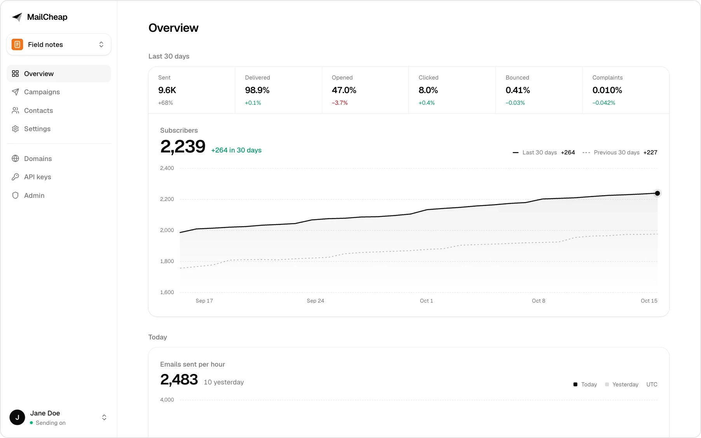
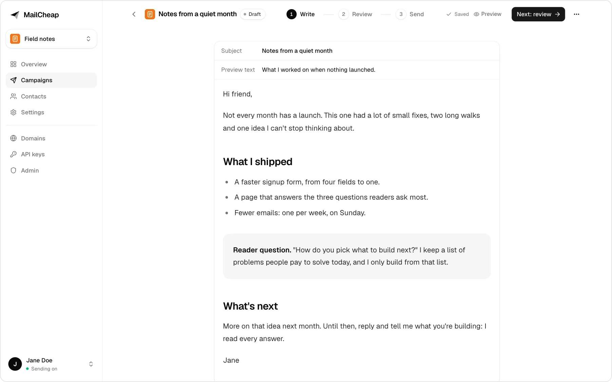
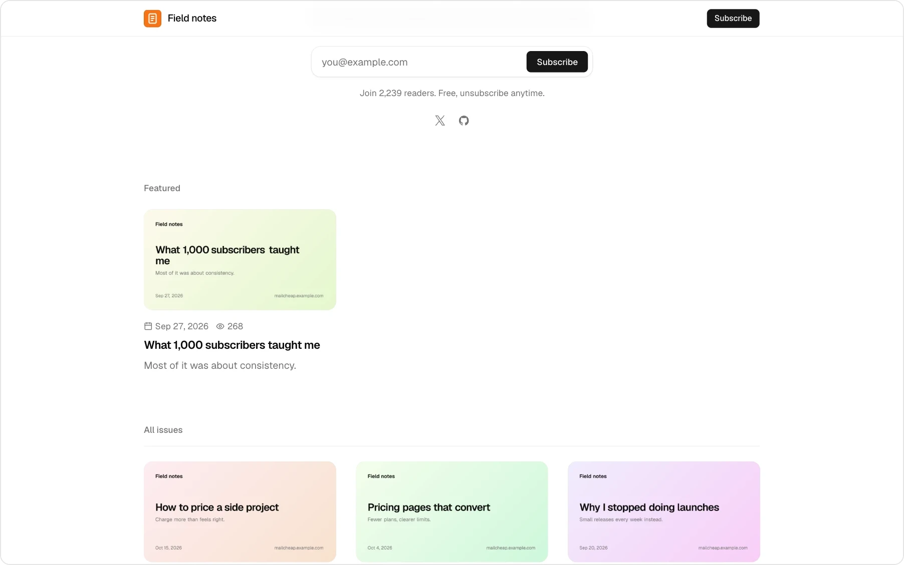

> FlockStack is a Cloudflare fork of [MailCheap](https://github.com/marclou/mailcheap) by Marc Lou (AGPL-3.0). It runs on Workers, D1 and R2: [PORT-PLAN.md](PORT-PLAN.md) has the architecture and what's left.

<p align="center">
  <a href="https://flockstack.io">
    <picture>
      <source media="(prefers-color-scheme: dark)" srcset="docs/logo-dark.svg">
      
    </picture>
  </a>
</p>

<h1 align="center">FlockStack</h1>

<p align="center">
  Newsletters where you pay for the emails you send, not for dormant subscribers.<br>
  A fraction of the price of beehiiv and the like.
</p>

<p align="center">
  <a href="https://flockstack.io">Website</a> ·
  <a href="https://flockstack.io/docs">Docs</a> ·
  <a href="https://flockstack.io/signin">Sign up for FlockStack Cloud</a>
</p>

<p align="center">
  <a href="LICENSE"></a>
  <a href="#self-hosting"></a>
  <a href="https://flockstack.io/docs/mcp"></a>
</p>



FlockStack is a newsletter app: write an issue, send it to your list, publish it on the web, from the dashboard or from your AI agent. This repository is the whole app. Self-host it with your own Amazon SES or PostShiba account, or use [FlockStack Cloud](https://flockstack.io), which runs this same code.

## Features

- **AI agents and the dashboard.** Everything the dashboard does also works from an AI agent through the MCP server, and from code through the REST API, with the same checks and limits. ChatGPT, Claude and Grok Bot connect with OAuth; Claude Code, Codex and Cursor with an API key. MCP marks sending as an action that can't be undone, so agents ask you first.
- **Write, review, send.** Write in an editor with slash commands, images and boxes, or send Markdown or a complete HTML email through the API and MCP. Review shows what to fix before sending: subject, preview text, unsubscribe link, Gmail's 100 KB clip, postal address, sender. Then send it, schedule it, or start with your most engaged readers and send to more later.
- **Imports from beehiiv, Substack and Mailchimp.** Their CSV exports import as they are, with each reader's status and signup date, and so do Kit's, MailerLite's, Buttondown's, Ghost's and EmailOctopus's.
- **A website for each newsletter**, on a free subdomain on FlockStack Cloud (`<slug>.flockstack.io`), or on your server: every issue gets a page search engines can find, with a signup form, an author page, share images and a sitemap.
- **Sending from your own domain**, with the DKIM, return path and DMARC records to add and a check for each. On FlockStack Cloud, a newsletter without a domain sends from its own shared address, `hello@<slug>.flockstack.io`.
- **Deliverability protections**, built in:
  - warm-up: contacts the account never emailed go out as a 5% slice first, and the rest 3 hours later if the slice's bounces and complaints stay low. On FlockStack Cloud, an account's sends also speed up as it proves clean volume;
  - list cleanup, on by default: readers who ignored several issues get one "do you still want this?" email, then stop getting issues;
  - contact cleaning: imports leave out invalid, misspelled (gmial.com), spam trap, role, throwaway and duplicate addresses, domains that can't receive email, and anyone who unsubscribed, bounced or complained before;
  - one never-email list for the whole server: an address the email provider says doesn't exist (for 180 days) or that turned out to be a spam trap (for good) is left out of every account's imports, signups and sends, and only a keyed hash of it is kept;
  - spam and bounce limits: a send pauses past 2% hard bounces or 0.08% complaints, and the account is blocked past 5% or 0.3%, or on a spam trap hit;
  - Gmail's spam rates, which Gmail never reports one complaint at a time: every email carries a `Feedback-ID` for Gmail's feedback loop (its campaign or newsletter, its account, its kind), and once an admin connects [Google Postmaster Tools](https://postmaster.google.com), FlockStack reads it every day. An account Gmail flags at 0.08% has its sends paused, at 0.3% it's blocked, and the admins hear when the whole domain reaches 0.1%;
  - one-click unsubscribe (RFC 8058) and a signed unsubscribe link in every email, and confirmed opt-in, on by default.
- **Several newsletters**: up to 3 per account, each with its own contacts, campaigns and website.
- **Signups and stats**: signup forms and a signup API, welcome emails, open and click tracking that leaves link scanners out, subscribers over time, and reports by inbox provider (Gmail, Outlook, Yahoo, iCloud...).

| Write, review, send | The newsletter's website |
| --- | --- |
|  |  |

All names and addresses in the screenshots are made up.

## FlockStack Cloud or self-hosted

| | [FlockStack Cloud](https://flockstack.io) | Self-hosted |
| --- | --- | --- |
| Price | From $12 a month for 20,000 emails | Free, plus what your provider charges per email: $0.10 to $0.16 per 1,000 on Amazon SES |
| Sending | Set up for you, from `hello@<slug>.flockstack.io` or your domain | Your Amazon SES or PostShiba account, from your domain |
| Website | `<slug>.flockstack.io` | `/archive/<slug>` on your server's domain |
| Who signs in | Anyone who signs up | The emails you allow |
| Limits | Emails a month and active subscribers, by plan | None |
| Setup | A few minutes | About an hour, most of it waiting for DNS and production access (SES) |
| Support | A chat in the dashboard | None: issues are off |

FlockStack Cloud is this repository with `FLOCKSTACK_CLOUD=true`, which adds open sign-up, plans and billing (Polar or Stripe). Only active subscribers count toward a plan, not the ones list cleanup marked dormant. Its landing page is in this repository too (`lib/marketing`, `components/marketing`); the legal pages aren't written yet. Every change to the app ships to both.

With your own sending account, you pay your provider for the emails you send: 10,000 readers and 4 issues a month is 40,000 emails, about $4 to $6 on Amazon SES.

## Self-hosting

FlockStack runs on Cloudflare Workers, with D1 for data and R2 for images, so the running cost is mostly what your email provider charges. Plan for about an hour, most of it waiting for DNS and for your provider to approve production sending. Self-hosting comes without support: issues are off and setup questions go unanswered.

### What you need

| Service | For | Cost |
| --- | --- | --- |
| [Cloudflare](https://cloudflare.com) (Workers, D1, R2) | Hosting, contacts, campaigns, stats and image uploads | Free tier to start; D1 is 10 GB per database |
| [Amazon SES](https://aws.amazon.com/ses/) or [PostShiba](https://postshiba.com) | Sending | SES: $0.10 to $0.16 per 1,000 emails, depending on its pricing plan. PostShiba: a fixed price per cluster, invite only for now |
| [Upstash QStash](https://upstash.com/docs/qstash) | Background sending and scheduling | Free tier to start (1,000 messages a day), then pay per message. One message sends 50 emails |
| [Upstash Redis](https://upstash.com/docs/redis) (optional) | Rate limits shared by every server instance, faster than the database | Free tier |

Rate limits are counted in D1 and shared by every Worker instance, so Redis is optional. Image uploads go to your R2 bucket, served from a domain you connect to it.

### Environment variables

Set them as Worker secrets (`wrangler secret put NAME`), or as `vars` in `wrangler.jsonc` for the ones that aren't secret.

| Variable | What it does |
| --- | --- |
| `BETTER_AUTH_SECRET` | Signs sessions and every link in sent emails. 32+ random characters (`openssl rand -base64 48`), or the server refuses to start. Rotating it signs everyone out and breaks links in emails already sent |
| `SUPPRESSION_HASH_KEY` | Keys the hashes of the never-email list every account shares. 32+ random characters of its own, never `BETTER_AUTH_SECRET`, or the server refuses to start, after an upgrade too. Changing it empties the list |
| `ADMIN_EMAILS` | Comma-separated emails that can sign in and open `/admin` |
| `ALLOWED_EMAILS` | Who else can sign in: addresses and `@domain` entries, comma-separated |
| `EMAIL_FROM` | From address of sign-in codes and alerts, on an identity your email provider verified |
| `APP_URL` | Public URL of the app, no trailing slash, for email links and sign-in |
| `SENDING_ENABLED` | Nothing goes to readers unless it's `true`. Sign-in codes and alerts don't wait for it |
| `SES_*` or `POSTSHIBA_*` | The email provider, in step 4 |
| `QSTASH_*` | Background sending and scheduling, in step 5 |

[`.env.example`](.env.example) lists every variable with what it does, the optional ones included: Google sign-in and Postmaster Tools, image uploads, Redis, Telegram alerts, the shared domain, billing, and FlockStack Cloud's own.

### 1. Database and storage

1. Install dependencies and log in: `npm ci && npx wrangler login`.
2. Create the D1 database and the R2 bucket, and put their names and ids in `wrangler.jsonc`: `npx wrangler d1 create flockstack`, `npx wrangler r2 bucket create flockstack-images`.
3. Create the tables: `npx wrangler d1 migrations apply flockstack --remote`. The SQL in `migrations/` comes from the models' schemas (`node scripts/docdb-schema.mjs`).
4. Connect a domain to the bucket for image uploads (`npx wrangler r2 bucket domain add flockstack-images --domain img.example.com --zone-id <zone>`) and set `IMAGES_CDN_URL` to it.

### 2. Deploy

1. Build and deploy: `npx opennextjs-cloudflare build && npx wrangler deploy`. Add your domain under `routes` in `wrangler.jsonc` (`{ "pattern": "app.example.com", "custom_domain": true }`) or use the workers.dev address.
2. Set `BETTER_AUTH_SECRET`, `SUPPRESSION_HASH_KEY`, `ADMIN_EMAILS`, `APP_URL` and `EMAIL_FROM` with `wrangler secret put`. With a short secret, FlockStack refuses to start and the logs say why.
3. Sign-in codes go out through your email provider once step 4 is done. Until then nobody can sign in with a code.
4. Open `<APP_URL>/signin` and sign in with your email, or add a passkey from the account page afterwards.

Sending stays off until you finish the next steps, so nothing goes out to readers by mistake. `/api/health` answers 200, or 503 with what to fix. Links in your emails use `APP_URL`, so it should be final before your first send.

### 3. Who can sign in

Only the emails you list: `ADMIN_EMAILS` (who can also open `/admin`) and `ALLOWED_EMAILS`, a comma-separated list of addresses and whole domains, like `jane@example.com, @example.org`. It's checked at every sign-in, with a code or with Google, and anyone you take off the list is signed out and loses their API keys at their next request. With both lists empty, nobody can sign in.

Everyone gets an account of their own, with up to 3 newsletters and their contacts and campaigns, and the account's domains and API keys. There's no billing on a self-hosted server: no plans, no limits.

### 4. Email provider

Pick Amazon SES or PostShiba (invite only for now). `EMAIL_PROVIDER` picks one; without it, FlockStack uses PostShiba when `POSTSHIBA_API_KEY` is set and SES otherwise. Every account gets its own tenant there, with its own domains, suppression list and pause switch. FlockStack creates them; you set up the provider account and its events once.

#### Amazon SES

Use one AWS region for everything below (the examples use `us-east-1`). An AWS account just for FlockStack is best: SES reputation and limits are per AWS account.

1. **Request production access.** New accounts are in the sandbox (200 emails a day, verified recipients only). In **Account dashboard > Request production access**, pick Marketing, and explain that readers opt in, that bounces and complaints are suppressed automatically, and that every email has one-click unsubscribe. AWS usually answers within a day.
2. **Create an SNS topic** for events, like `flockstack-ses-events`, and switch it to signature version 2, which signs messages with SHA256 instead of SHA1: `aws sns set-topic-attributes --topic-arn <topic-arn> --attribute-name SignatureVersion --attribute-value 2`. Then **Create subscription** with protocol HTTPS and endpoint `https://<your-app>/api/webhooks/ses`, raw message delivery off. FlockStack confirms the subscription by itself once it's deployed with the variables of step 4.
3. **Create an IAM user for FlockStack** with this policy, then create an access key for it:

```json
{
  "Version": "2012-10-17",
  "Statement": [
    {
      "Effect": "Allow",
      "Action": [
        "ses:SendEmail",
        "ses:GetAccount",
        "ses:CreateTenant",
        "ses:GetTenant",
        "ses:DeleteTenant",
        "ses:TagResource",
        "ses:CreateTenantResourceAssociation",
        "ses:DeleteTenantResourceAssociation",
        "ses:UpdateReputationEntityPolicy",
        "ses:UpdateReputationEntityCustomerManagedStatus",
        "ses:CreateConfigurationSet",
        "ses:CreateConfigurationSetEventDestination",
        "ses:DeleteConfigurationSet",
        "ses:PutConfigurationSetDeliveryOptions",
        "ses:CreateDedicatedIpPool",
        "ses:DeleteDedicatedIpPool",
        "ses:CreateEmailIdentity",
        "ses:GetEmailIdentity",
        "ses:PutEmailIdentityMailFromAttributes",
        "ses:DeleteEmailIdentity"
      ],
      "Resource": "*"
    }
  ]
}
```

4. **Add the variables** and redeploy: `SES_REGION`, `SES_ACCESS_KEY_ID`, `SES_SECRET_ACCESS_KEY`, `SES_AWS_ACCOUNT_ID` (the 12-digit account ID) and `SES_SNS_TOPIC_ARN`. Each account's configuration set publishes its events to that topic.
5. **Optional: tenant pauses.** SES pauses tenants that send badly. To block the account in FlockStack too, send SES's tenant status and reputation finding events from EventBridge to a second SNS topic, subscribe `https://<your-app>/api/webhooks/ses-tenants` to it, and set `SES_TENANT_SNS_TOPIC_ARN`.

Sign-in codes and alerts go out through SES from `EMAIL_FROM`, outside every tenant, so its domain has to be verified in the AWS account before your first sign-in: **Identities > Create identity > Domain**, with Easy DKIM. In the sandbox, the addresses you sign in with have to be verified too.

#### PostShiba

PostShiba approves production sending by hand: until then, sends to anyone outside your team answer `kyc_required` (campaigns pause with that reason) and a team can have one cluster.

1. **Team and key.** In API keys, create a full access key: `POSTSHIBA_API_KEY`, with the team id as `POSTSHIBA_TEAM_ID`. Add a payment method (clusters need one).
2. **Clusters.** One `bulk` cluster sends every email: its id goes in `POSTSHIBA_BULK_CLUSTER_ID`. Later, a `transactional` cluster in `POSTSHIBA_TRANSACTIONAL_CLUSTER_ID` takes welcome, confirmation and test emails, so they never wait behind a campaign. Set `SEND_RATE_PER_SECOND` to the bulk cluster's hourly cap divided by 3,600, less what welcome and test emails need when they share it. At a cap, PostShiba answers `throttled`: the batch goes back to the queue and QStash brings it after the hour.
3. **Webhook.** One endpoint for the whole team (no cluster or tenant) at `https://<your-app>/api/webhooks/postshiba` with the events `processed`, `delivered`, `deferred`, `bounce`, `dropped`, `spamreport` and `unsubscribe`. Its secret goes in `POSTSHIBA_WEBHOOK_SECRET`.
4. **Encryption key.** `CREDENTIALS_ENCRYPTION_KEY`, generated once with `openssl rand -base64 32`. It encrypts each tenant's SMTP password, and Postmaster Tools' refresh token.

FlockStack creates the rest: a tenant per account (slug `mc-<accountId>`), an SMTP credential for it on each cluster (one in all on a single cluster), and its domains. Creating credentials and domains and running domain checks share PostShiba's budget of 60 an hour per key; a failed setup is retried at the account's next send.

Sign-in codes and alerts go through a tenant of their own, `mc-platform`, on the transactional cluster. The first one adds `EMAIL_FROM`'s domain there, and the server log lists the two CNAME records it needs; once PostShiba finds them, codes go out. A domain belongs to one tenant at PostShiba, so `EMAIL_FROM` needs a domain or subdomain that no newsletter sends from.

### 5. QStash

1. In the [Upstash console](https://console.upstash.com/qstash), open QStash and copy `QSTASH_TOKEN`, `QSTASH_CURRENT_SIGNING_KEY` and `QSTASH_NEXT_SIGNING_KEY` (and `QSTASH_URL` if you picked a region other than the default).
2. Add them and redeploy.

QStash calls `APP_URL/api/jobs/...` to send each batch, so the app has to be reachable on the internet. FlockStack checks QStash's signature on every job.

### 6. Turn sending on

1. In FlockStack, open **Domains** and add the domain your newsletter sends from. Use a subdomain like `mail.example.com`, so your main domain's email is unaffected. Add the DNS records it lists (DKIM, return path, and DMARC if your root domain has none), then click **Check now**.
2. Create your newsletter. The from address must be on that domain, and the postal address shows in every email's footer (anti-spam laws require one).
3. Set `SENDING_ENABLED=true` and redeploy.
4. Write a campaign, send yourself a test, then send. A first send to new contacts goes out in steps by itself; for a new domain, also set a limit to reach your most engaged readers first, and use **Send to more** on the report once the first step looks healthy.

### Optional

- **Google sign-in.** Create an OAuth client (web application) with the redirect URI `<APP_URL>/api/auth/callback/google`, then set `GOOGLE_CLIENT_ID` and `GOOGLE_CLIENT_SECRET`. The allowlist applies, and a Google sign-in joins an existing user only when Google verified that email.
- **Gmail's spam rates (Google Postmaster Tools).** It needs the Google sign-in client above, `CREDENTIALS_ENCRYPTION_KEY` and `CRON_SECRET`; without them, or until someone connects, nothing runs.
  1. In the client's Google Cloud project, enable the **Gmail Postmaster Tools API**, and add `<APP_URL>/api/admin/postmaster/callback` to the client's authorized redirect URIs. Its consent screen has to be published (In production): in Testing, Google expires the connection after 7 days.
  2. At [postmaster.google.com](https://postmaster.google.com), add the domain every email is DKIM-signed with: `SHARED_DOMAIN`, which PostShiba's primary domain signing adds to every email, or `POSTMASTER_DOMAIN`. A domain the same Google account verified in Search Console is verified already.
  3. On `/admin`, under **Gmail spam rates**, click **Connect** and allow access with that Google account. Google warns that it hasn't verified the app: it's your own, continue. FlockStack asks for read access to traffic statistics only, and stores the refresh token encrypted with `CREDENTIALS_ENCRYPTION_KEY`.

  Have a scheduler (a Cloudflare cron trigger, or any other) call `/api/cron/postmaster` every day with `Authorization: Bearer <CRON_SECRET>`. It acts on the newest day of Gmail's data once, with the thresholds in `POSTMASTER` (`lib/config.js`). Gmail only reports domains that send to at least 50 Gmail users a day, and a feedback ID once it has enough emails and spam reports, so until then it finds nothing and says nothing. If Google refuses the connection, one alert says so. Every email's `Feedback-ID` is `<campaign or newsletter id>:mc-<accountId>:<kind>:flockstack` (`lib/sending-rules.js`): SES sends it as it is, and PostShiba writes its own in its place, also led by `mc-<accountId>`, so each ID maps back to its account (`lib/postmaster-rules.js`).
- **Image uploads.** On Cloudflare they go to the R2 bucket bound as `IMAGES` (set `IMAGES_STORAGE=r2` and `IMAGES_CDN_URL`, step 1). To use Amazon S3 instead, put an S3 bucket behind CloudFront on a subdomain of your own (like `cdn.example.com`); it takes over new uploads, and images already stored keep their URLs:
  1. Create a private S3 bucket with Block Public Access on.
  2. In ACM, request a certificate for the subdomain in `us-east-1`, validated by DNS. If your domain has CAA records, add `0 issue "amazon.com"`.
  3. Create a CloudFront distribution: the bucket as origin through Origin Access Control (add the bucket policy CloudFront gives you), viewer protocol HTTPS only, the CachingOptimized cache policy, and the subdomain as alternate domain name with that certificate. Point the subdomain at the distribution with a CNAME.
  4. Create an IAM user for FlockStack with this policy, then an access key for it. Deleting an account deletes its images and clears them from CloudFront's cache, hence `s3:DeleteObject` and `cloudfront:CreateInvalidation`:

     ```json
     {
       "Version": "2012-10-17",
       "Statement": [
         {
           "Effect": "Allow",
           "Action": ["s3:PutObject", "s3:GetObject", "s3:DeleteObject"],
           "Resource": "arn:aws:s3:::<bucket>/accounts/*"
         },
         {
           "Effect": "Allow",
           "Action": ["cloudfront:CreateInvalidation"],
           "Resource": "arn:aws:cloudfront::<aws-account-id>:distribution/<distribution-id>"
         }
       ]
     }
     ```

  5. Set `IMAGES_S3_BUCKET`, `IMAGES_S3_REGION`, `IMAGES_S3_ACCESS_KEY_ID`, `IMAGES_S3_SECRET_ACCESS_KEY`, `IMAGES_CDN_URL` (like `https://cdn.example.com`) and `IMAGES_CLOUDFRONT_DISTRIBUTION_ID` (the distribution's ID), and redeploy. Builds read `IMAGES_CDN_URL` too.

  Each image gets a name that never changes and `Cache-Control: public, max-age=31536000, immutable`, so CloudFront and browsers keep it for a year. An account's purge invalidates its folder, `/accounts/<accountId>/*`, on the distribution, so CloudFront stops serving its deleted images.
- **Shared rate limits.** Create a Redis database in the [Upstash console](https://console.upstash.com/redis) and add `UPSTASH_REDIS_REST_URL` and `UPSTASH_REDIS_REST_TOKEN`.
- **Alerts on Telegram.** Every admin alert is an email to `ADMIN_EMAILS`. The ones that need someone (an automatic account block, the email provider refusing FlockStack's sends or holding a tenant, Gmail's spam rate for the domain reaching 0.1% or Postmaster Tools refusing the connection, sign-in codes, Stripe events, webhooks or background jobs failing, QStash refusing jobs, shared addresses and the DNS helper) can reach Telegram too: create a bot with [@BotFather](https://t.me/BotFather), send it a message, and set `TELEGRAM_BOT_TOKEN` and the chat's id as `TELEGRAM_CHAT_ID`. Each alert goes there at most once every 6 hours. On PostShiba, have a scheduler call `/api/cron/hourly` every hour with `Authorization: Bearer <CRON_SECRET>` (Vercel Cron sends it once `CRON_SECRET` is set): it checks the team's status (a suspension, the approval, clusters at their cap, held tenants) and alerts on what stops sending. Its first run with Telegram set up posts "Telegram alerts are on".
- **Shared domain.** `SHARED_DOMAIN` is how FlockStack Cloud gives every newsletter without a domain of its own an address, `hello@<slug>.SHARED_DOMAIN`, and its website at `<slug>.SHARED_DOMAIN`. FlockStack adds each subdomain at the provider and has its records published, and removed when the slug changes, by a DNS helper (`DNS_BROKER_URL`, `DNS_BROKER_SECRET`): on FlockStack Cloud a Vercel project of its own that holds the Vercel token, so the app never does, and only writes a shared address's records. The helper isn't part of this repository, and without one DNS automation is off and shared addresses can't be set up. Its DNS has to be on Vercel, with `*.SHARED_DOMAIN` on the project. Add one DMARC record for the whole domain yourself: `_dmarc.SHARED_DOMAIN` TXT `v=DMARC1; p=none;`. It can be the app's own domain, as FlockStack Cloud's is `flockstack.io`: slugs can't take `www` or the other names in `lib/reserved-slugs.js`, and those hosts never open a website.

### Sending well

- **Send from a subdomain** (`mail.example.com`), so a bad week doesn't affect your main domain's email.
- **Authenticate everything:** DKIM, SPF through the custom return path, and DMARC on the root domain.
- **Only email people who asked.** Never import a bought or scraped list. If bots fill your forms, keep confirmed opt-in on.
- **Warm up a new domain.** Send to your most engaged readers first, and grow each send over a few weeks.
- **Watch complaints and bounces.** Keep complaints under 0.1% and bounces under 2%. FlockStack pauses a send past 0.08% complaints or 2% bounces, and blocks the account past 0.3% complaints or 5% bounces. Gmail only shows its spam rate in [Google Postmaster Tools](https://postmaster.google.com): connect it on `/admin` and FlockStack holds each account to the same levels there.
- **Make leaving easy.** Every email has one-click unsubscribe headers and a footer link, which Gmail and Yahoo require.
- **Clean your list.** Keep list cleanup on to stop emailing people who never open. New newsletters start with it on.
- **Keep emails under 100 KB**, or Gmail clips them and hides the unsubscribe link.

<details>
<summary><b>Billing, as on FlockStack Cloud</b></summary>

<br>

`FLOCKSTACK_CLOUD=true` is what [flockstack.io](https://flockstack.io) runs with: sign-up open to anyone, a newsletter setup at `/welcome` right after sign-in, a dashboard to try before paying with a paywall on sending, imports, domains and API keys, plan limits, and FlockStack's own emails through Resend when `RESEND_API_KEY` is set, else through your email provider. It refuses to start without a way to send those emails, and `/api/health` answers 503 with the reason. Billing is Polar when `POLAR_ACCESS_TOKEN` is set, else Stripe when `STRIPE_SECRET_KEY` is; with neither, accounts can sign up but nothing can be bought, so nothing can be sent. Set `FLOCKSTACK_CLOUD` for builds too: the public pages read it then.

| Plan | Monthly | Yearly | Emails per month | Active subscribers |
| --- | --- | --- | --- | --- |
| Starter | $12 | $120 | 20,000 | 10,000 |
| Growth | $27 | $270 | 75,000 | 40,000 |
| Pro | $55 | $550 | 200,000 | 100,000 |
| Scale | $109 | $1,090 | 500,000 | 250,000 |
| Max | $299 | $2,990 | 2,000,000 | 1,000,000 |

`lib/plans.js` is the one place these live. Yearly plans get the monthly allowance every month of the paid year. Every email counts toward the month: issues, tests, welcome and confirmation emails. Over a limit, campaigns stop with a clear message and an upgrade link; signups and confirmation emails keep going. Welcome emails take room in the month's emails like issues: once they're used up, each one is skipped (its `Message` says why), the owner gets one email that month, and the dashboard says so next to the welcome email, on the overview and on the billing page. They start again when the month resets or the plan grows; the skipped ones aren't sent later. Admin overrides replace a plan's numbers for one account.

Admins can give an account a free plan from `/admin` (the account's menu, **Give a free plan**): any of the five, with an optional end date, without Stripe. It works like a paid plan, its emails start over every month from the day it was given, and the billing page and `get_billing` (REST API and MCP) show it. A plan the account pays for takes over while there's one. **End free plan**, or its end date, stops it like a canceled plan: the data stays and sending stops.

**With Polar:** create an organization access token (scopes for products, checkouts, customer sessions and subscriptions), run `POLAR_ACCESS_TOKEN=... node scripts/polar-setup.mjs` to create the ten products (it only creates what's missing; `--dry-run` shows what it would do), add a webhook at `<APP_URL>/api/webhooks/polar` for the `subscription.*` events and `order.paid`, and set `POLAR_ACCESS_TOKEN`, `POLAR_WEBHOOK_SECRET` (and `POLAR_SERVER=sandbox` while testing). Switching plans and cancelling happen in Polar's customer portal.

**With Stripe:**

1. **Prices by lookup key.** Create five products (Starter, Growth, Pro, Scale, Max), each with a monthly and a yearly recurring USD price, and give every price its lookup key: `flockstack_<plan>_monthly` and `flockstack_<plan>_yearly`, like `flockstack_growth_yearly`. Checkout finds prices by these keys and refuses one whose amount or interval doesn't match `lib/plans.js`, so no price ID goes in the environment. A plan shows on the pricing pages, the paywall, billing and `get_billing` only once Stripe has both of its prices at those amounts: the app reads them every 10 minutes, and the static pages when they're built, so redeploy after adding one.
2. **Webhook.** Add an endpoint at `<APP_URL>/api/webhooks/stripe` with the events `checkout.session.completed`, `customer.subscription.created`, `customer.subscription.updated`, `customer.subscription.deleted` and `invoice.paid`. Use API version `2026-09-30.endive` (the one `stripe@23` pins) and put its signing secret in `STRIPE_WEBHOOK_SECRET`.
3. **Customer Portal.** Turn on payment method updates, invoices, cancellation (at the end of the period) and plan changes between the ten prices. Charge upgrades at once, with prorations invoiced immediately, and schedule downgrades, a cheaper price or a shorter interval, for the end of the period: otherwise an account can upgrade, send a bigger plan's emails and downgrade before the difference is billed. The billing page's "Switch" buttons open the portal's confirm page for one plan; without plan changes on, they open the portal's home.

Every subscription event re-reads the subscription from Stripe, so events arriving out of order can't leave stale data. Canceled accounts keep their data: sending, signups and the website stop, and everything comes back when they subscribe again.

</details>

## AI agents, REST API and MCP

Create a key on the **API keys** page and send it as `Authorization: Bearer <key>`. A full access key can do everything the dashboard can; a signups only key can only add contacts, for keys that sit in a website's code. Every key gets 300 requests a minute.

**Add a contact**: `POST /api/v1/contacts`

```bash
curl -X POST https://<your-app>/api/v1/contacts \
  -H "Authorization: Bearer $FLOCKSTACK_API_KEY" \
  -H "Content-Type: application/json" \
  -d '{"email":"jane@example.com","source":"website","ip":"203.0.113.7"}'
```

**MCP**: connect Claude Code with a full access key. Every action is a tool.

```bash
claude mcp add --transport http --scope user flockstack https://<your-app>/mcp \
  --header "Authorization: Bearer $FLOCKSTACK_API_KEY"
```

ChatGPT, Claude and Grok Bot add `https://<your-app>/mcp` as a connector or custom MCP server and sign in with OAuth: you sign in to FlockStack and allow the app on a consent page, and it gets full access to that account. The **API keys** page lists connected apps and revokes them. They need the server to be reachable over HTTPS from the internet.

`/docs` on your server has every endpoint, the errors, the MCP setup for ChatGPT, Claude, Grok Bot, Claude Code, Codex and Cursor, and the OpenAPI document at `/api/v1/openapi.json`. On FlockStack Cloud, the same at [flockstack.io/docs](https://flockstack.io/docs) and `https://flockstack.io/mcp`.

## Contributing

Read [AGENTS.md](AGENTS.md) first, whether you're a person or an AI agent: how the app is organized, FlockStack Cloud and self-hosting, the rules (no secrets or personal data in code, tests or commits), code style and tests. [SECURITY.md](SECURITY.md) covers what's built in and the known gaps. Issues are off, and pull requests may not be reviewed.

You need Node.js 22+ (local runs and tests use its built-in SQLite):

```bash
git clone <your fork> && cd flockstack
npm install
cp .env.example .env.local   # set FLOCKSTACK_SQLITE=./local.db, BETTER_AUTH_SECRET, SUPPRESSION_HASH_KEY, ADMIN_EMAILS
npm run dev
```

- Without `FLOCKSTACK_CLOUD` it runs as a self-hosted server: sign in with an email in `ADMIN_EMAILS` or `ALLOWED_EMAILS`. Without `RESEND_API_KEY`, development prints the code in the server console (`[signin] Code for ...`); production never does.
- `FLOCKSTACK_SQLITE=./local.db` keeps a local SQLite file instead of D1. To run it on the Workers runtime with local D1 and R2, use `npx opennextjs-cloudflare build && npx wrangler dev` with the secrets in `.dev.vars`.
- To work on FlockStack Cloud's own parts, set `FLOCKSTACK_CLOUD=true` and a way to send its own emails (SES keys, or `RESEND_API_KEY`). For billing, Polar's sandbox (`POLAR_SERVER=sandbox`) or Stripe test keys with `stripe listen --forward-to localhost:3000/api/webhooks/stripe`.
- Sending stays off unless `SENDING_ENABLED=true`. SES needs `SES_ACCESS_KEY_ID` and `SES_SECRET_ACCESS_KEY`: the app never falls back to `~/.aws` or other default AWS credentials. PostShiba needs its four ids and keys and `CREDENTIALS_ENCRYPTION_KEY`.
- QStash can't reach `localhost`. To try a full send locally, run the QStash dev server (`npx @upstash/qstash-cli dev`) and use the URL, token and signing keys it prints.

Before a pull request, run the full suite, lint and a build:

```bash
npm test       # unit and integration tests
npm run lint
npm run build
```

Each integration test file gets its own in-memory SQLite, and `node scripts/test-all.mjs <log directory>` runs the files in parallel. They import server actions and route handlers as they are, and `tests/setup` replaces every outside service with the stubs in `tests/stubs`, so nothing reaches the network. `tests/parity.test.mjs` fails when an action is missing from the REST API, MCP, the OpenAPI document, the docs or the llms files.

## License

[GNU Affero General Public License v3.0](LICENSE). Copyright (C) 2026 Marc Lou (MailCheap) and FlockStack's contributors.

If you change FlockStack and run it for other people, the AGPL asks you to offer them the source of your version: point the "Source code" link (`SOURCE_URL` in `lib/site.js`) at it. The one-time release before this license, [67d13b0](https://github.com/marclou/mailcheap/tree/67d13b028a6ecae9ec56d49c4b2db58019217eba) in github.com/marclou/mailcheap's history, stays under MIT.

FlockStack is a fork of MailCheap, made by [Marc Lou](https://x.com/marclou).
